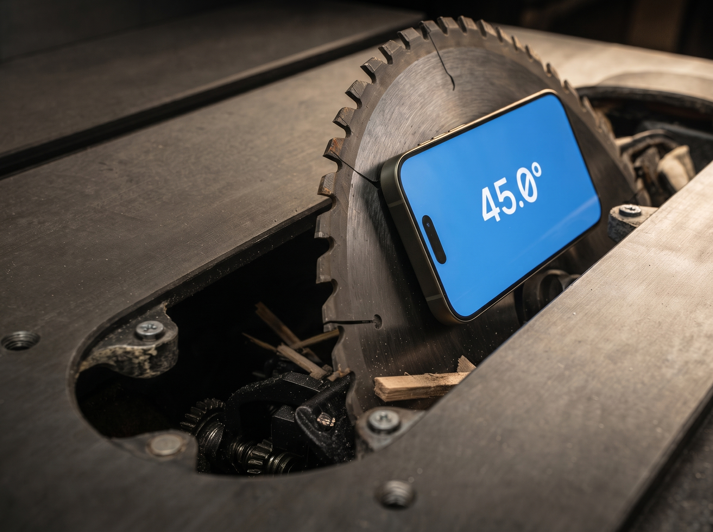
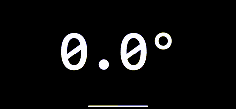

# Level Pro


**Level Pro** is an iOS app designed to provide highly accurate angle measurements using your device’s gyroscope, making it a handy tool for tasks like setting up a table saw blade or other precision work. As a more precise alternative to the built-in iOS Measure app, Level Pro allows calibration and reset of the reference angle with ease, and offers measurement accuracy up to 0.1°. The app also provides visual feedback through background color changes and haptic feedback when key angles (0°, 45°, 90°) are reached.

## Features

- **Accurate Angle Measurement**: Measures angles relative to the device’s initial position with precision up to 0.1°.
- **Calibration**: Tap once anywhere on the screen to set a new reference angle.
- **Reset**: Double-tap the screen to reset the angle measurement to the default (0°).
- **Color Change**: The background changes to green at 0°, and blue at 45° and 90°.
- **Haptic Feedback**: Provides a short buzz when 0°, 45°, or 90° are reached.



## Installation

1. **Clone the Repository**:

    ```bash
    git clone <repository-url>
    ```

2. **Open in Xcode**:
    - Open the project in Xcode by double-clicking the `.xcodeproj` file.

3. **Build and Run**:
    - Ensure your iOS device is connected or use the simulator.
    - Build the project (`Cmd+B`) and run it (`Cmd+R`).

## How to Use

1. **Start the App**:
    - Upon launching, the app will display the current angle in degrees.

2. **Calibrate**:
    - Tap anywhere on the screen to set the current angle as the new 0° reference.

3. **Reset**:
    - Double-tap anywhere on the screen to reset the reference angle to the default.

4. **Observe Feedback**:
    - The background will turn green when the angle is 0°.
    - It will turn blue when the angle is close to 45° or 90°.
    - You will receive haptic feedback when the angle is exactly 0°, 45°, or 90°.

## Requirements

- Xcode 12.0+
- iOS 14.0+ (or higher)
